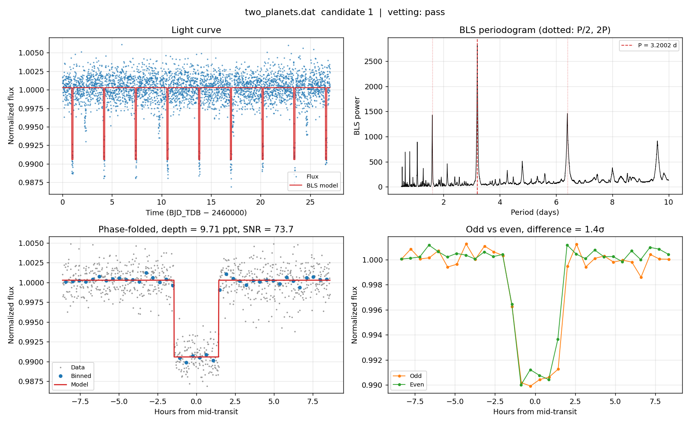
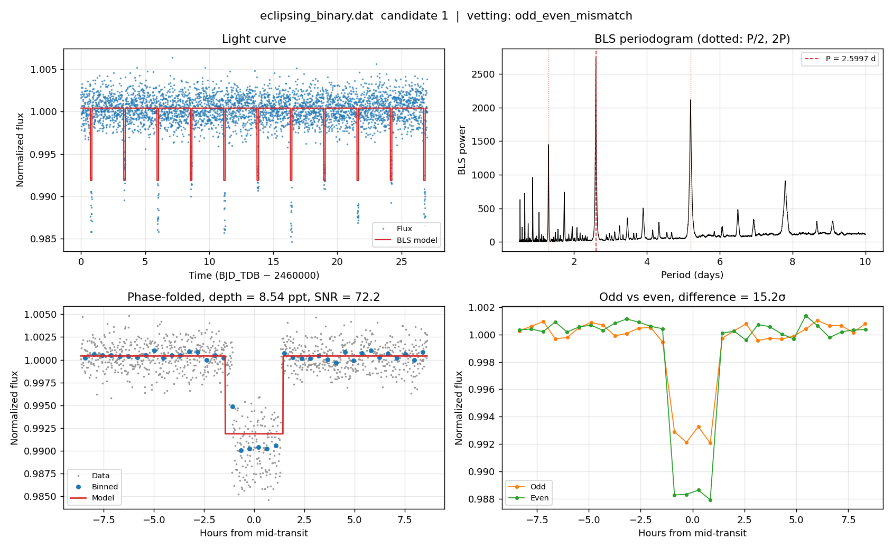

# 🪐 Transit Search: BLS Exoplanet Detection and Vetting


A Python pipeline that searches photometric light curves for periodic exoplanet transits, **finds multiple planets per star**, **flags likely false positives**, and **estimates planet sizes**. Each light curve is cleaned and detrended, searched with **Box Least Squares (BLS)**, and every candidate gets a four-panel diagnostic figure plus a row in a summary table.

It works directly on **AstroImageJ** `.dat` measurement tables and on any whitespace-separated time–flux file.


*A synthetic planet (P = 3.2 d, depth = 1%) recovered from the included example data: light curve, periodogram, phase-folded transit and odd/even comparison.*

---

## Features

- **Cleaning and detrending:** removes invalid points, normalizes, divides out a polynomial trend, and clips upward outliers (cosmic rays) while keeping transit points
- **BLS search** over a grid of trial periods *and* transit durations
- **Multi-planet search:** after each detection the transits are masked and the search repeats, until no signal is above the SNR threshold
- **Candidate vetting** to catch eclipsing binaries and spurious signals:
  - *Odd/even depth test:* an eclipsing binary at twice the period shows alternating depths
  - *Secondary eclipse test:* a significant dip at phase 0.5 suggests a stellar companion
  - *Transit count:* warns when fewer than two transits are observed, so the period is unconstrained
  - *SNR threshold:* signals below the threshold are not reported
- **Planet size:** Rp/R★ from the transit depth, plus radius in Earth and Jupiter radii when the stellar radius is given
- **Outputs:** a diagnostic PNG for every candidate and a `bls_summary.csv` table

## Installation

```bash
git clone https://github.com/Jiqbal-astro/Light-curve-analysis-to-search-for-planetary-transit-signal.git
cd Light-curve-analysis-to-search-for-planetary-transit-signal
pip install -r requirements.txt
```

## Quick start

Run the pipeline on the included synthetic examples:

```bash
python transit_search.py example_data --rstar 0.9
```

Expected output:

```
Processing eclipsing_binary.dat ...
  candidate 1: P = 2.5997 d, depth = 8.54 ppt, SNR = 72.2, Rp/R* = 0.092, Rp = 9.07 R_earth  [odd_even_mismatch]
Processing two_planets.dat ...
  candidate 1: P = 3.2002 d, depth = 9.71 ppt, SNR = 73.7, Rp/R* = 0.099, Rp = 9.67 R_earth  [pass]
  candidate 2: P = 7.4518 d, depth = 4.12 ppt, SNR = 25.5, Rp/R* = 0.064, Rp = 6.30 R_earth  [pass]
```

Both planets in `two_planets.dat` are recovered, and the eclipsing binary is correctly flagged.

Run it on your own data:

```bash
python transit_search.py path/to/light_curves -o results --min-period 0.5 --max-period 15 --rstar 1.0
```

## Vetting example

`eclipsing_binary.dat` contains a binary star whose eclipses alternate in depth. BLS finds a strong signal at half the true orbital period, but the odd/even test shows the two sets of eclipses differ by more than 15σ, so the candidate is flagged rather than reported as a planet.



## Outputs

Results are written to the output folder (default `results/`):

| File | Contents |
|---|---|
| `<name>_c<k>.png` | Diagnostic figure for candidate *k*: light curve, periodogram, phase-folded transit, odd vs even transits |
| `bls_summary.csv` | One row per candidate (see below) |

Columns in `bls_summary.csv`:

| Column | Meaning |
|---|---|
| `period_days`, `t0`, `duration_days` | Best-fit period, mid-transit time (BJD_TDB) and duration |
| `depth`, `depth_err`, `depth_snr` | Transit depth (fractional), its uncertainty and signal-to-noise |
| `rp_rs`, `rp_earth`, `rp_jup` | Planet-to-star radius ratio, and planet radius if `--rstar` is given |
| `n_transits` | Number of individual transits with data |
| `depth_odd`, `depth_even`, `odd_even_sigma` | Odd and even transit depths and their difference in σ |
| `secondary_depth`, `secondary_sigma` | Depth at phase 0.5 and its significance |
| `flags` | `pass`, or any of `low_snr`, `single_transit`, `odd_even_mismatch`, `secondary_eclipse` |

## Input format

Whitespace-separated text files, one light curve per file. Lines starting with `#` are ignored and a header row is allowed:

```
BJD_TDB          rel_flux_T1
2460000.000000   1.001243
2460000.006944   0.998871
...
```

AstroImageJ measurement tables work as-is, provided the time and target relative-flux columns are the first two.

## Options

| Option | Default | Description |
|---|---|---|
| `-o, --output` | `results` | Output directory |
| `--extension` | `.dat` | File extension to read |
| `--min-period` / `--max-period` | `0.5` / `10` | Trial period range (days) |
| `--n-periods` | `10000` | Number of trial periods |
| `--durations` | `0.04 … 0.2` | Trial transit durations (days); must be shorter than `--min-period` |
| `--max-planets` | `3` | Maximum number of signals to search for per file |
| `--snr-threshold` | `7` | Minimum depth SNR to report a candidate |
| `--mask-factor` | `1.5` | Width of the mask applied to found transits, in transit durations |
| `--rstar` | none | Stellar radius in solar radii, to convert depth into planet radius |
| `--poly-degree` | `3` | Degree of detrending polynomial |
| `--sigma` | `3` | Upper sigma-clipping threshold |
| `--smooth` | off | Apply Savitzky–Golay smoothing before the search |
| `--window` | `51` | Savitzky–Golay window length (points, odd) |

## Notes and limitations

- **Avoid `--smooth` when vetting.** Smoothing makes neighbouring points correlated, which inflates SNRs and can trigger false odd/even flags. It can also make transits look shallower when the window is close to the transit duration.
- **Baseline matters.** A period can only be measured if the data cover at least two transits. Single-night ground-based light curves will be flagged `single_transit`.
- **Detrending.** A single global polynomial suits short or smoothly varying light curves. Long, multi-sector space data (e.g. TESS) are better served by a sliding-window detrender such as [`wotan`](https://github.com/hippke/wotan).
- **Planet radius is approximate.** Rp/R★ = √depth ignores limb darkening and grazing geometry, and BLS depths are averaged over the box, so radii are typically slight underestimates. Fit a physical transit model (e.g. `batman`) for publication-quality parameters.
- Passing the vetting checks makes a signal a **candidate**, not a confirmed planet. Further checks include centroid analysis, nearby contaminating stars and radial-velocity follow-up.

## Repository structure

```
├── transit_search.py                  # main pipeline
├── example_data/
│   ├── two_planets.dat                # synthetic two-planet system
│   └── eclipsing_binary.dat           # synthetic false positive
├── docs/                              # figures used in this README
├── requirements.txt
└── LICENSE
```

## References

- Kovács, G., Zucker, S. & Mazeh, T. (2002), *A box-fitting algorithm in the search for periodic transits*, A&A, 391, 369
- Seager, S. & Mallén-Ornelas, G. (2003), *A unique solution of planet and star parameters from an extrasolar planet transit light curve*, ApJ, 585, 1038
- Astropy Collaboration, [`BoxLeastSquares` documentation](https://docs.astropy.org/en/stable/timeseries/bls.html)

## Author

**Javed Iqbal**: astronomy researcher working on exoplanets and variable stars
[GitHub](https://github.com/Jiqbal-astro) · [Website](https://jiqbal-astro.github.io) · [LinkedIn](https://www.linkedin.com/in/jiqbal-astro/)

Released under the [MIT License](LICENSE).
